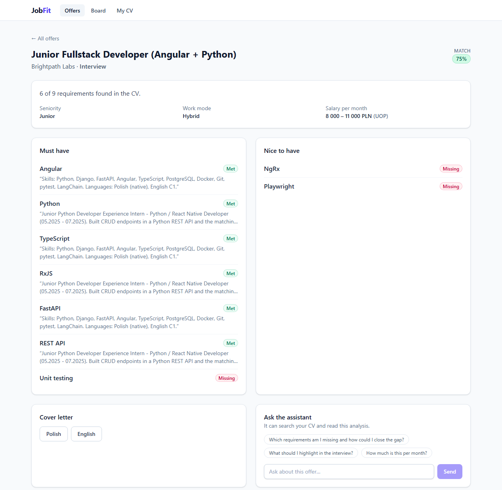
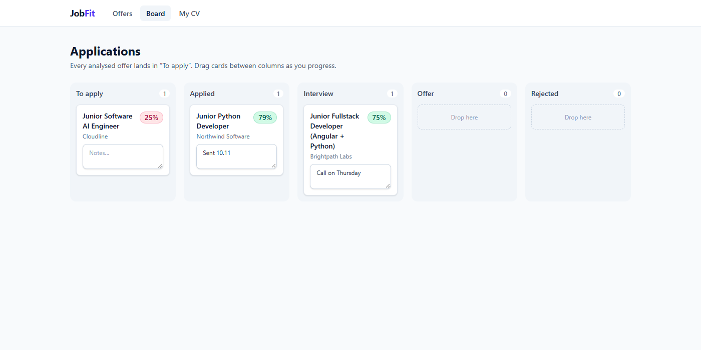
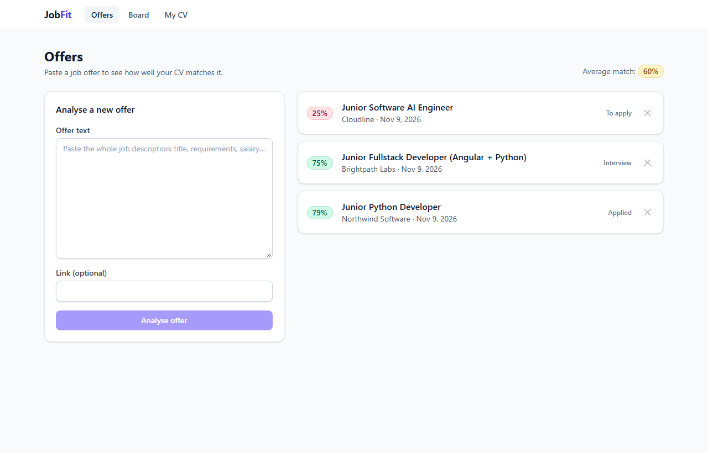
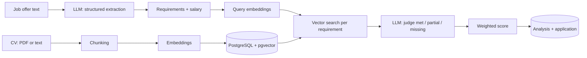

# JobFit

**Paste a job offer, see how well your CV fits it.** JobFit extracts the requirements from an
offer with an LLM, finds evidence for each of them in your CV with vector search, scores the
match, normalises the salary, drafts a cover letter and tracks your applications on a board.
An assistant with tool calling answers follow-up questions about a specific offer.

> **Live demo:** https://jobfit-yh66iyjaxq-ew.a.run.app - sample CV and offers, real Gemini analysis for new offers
> (data resets nightly). Runs on Google Cloud Run, see [Deployment](#deployment).

| Offer analysis | Application board |
| --- | --- |
|  |  |



## How it works



1. **CV ingestion** - the CV is split into overlapping chunks, embedded and stored in pgvector
   (HNSW index, cosine distance).
2. **Extraction** - the LLM returns a Pydantic-validated `OfferExtraction`: title, company,
   seniority, work mode, every requirement marked *must* or *nice to have*, and the salary.
3. **Evidence** - each requirement is embedded as a query and matched against the CV chunks.
4. **Judgement** - the LLM sees only the retrieved excerpts and marks every requirement as
   *met*, *partial* or *missing*, quoting the CV.
5. **Score** - must-haves weigh twice as much as nice-to-haves, partial counts as half.
6. **Salary** - hourly, daily and yearly rates are converted to a monthly amount (168 h / 21 days).

### Offer assistant (tool calling)

`POST /api/offers/{id}/ask` runs a small agent loop: the model can call tools until it is ready
to answer, and every step is returned so you can see what it looked up.

| Tool | What it does |
| --- | --- |
| `search_cv` | Vector search over your CV |
| `get_offer_analysis` | Requirements, match status, score and salary of the offer |
| `convert_salary` | Deterministic salary conversion to a monthly amount |

The loop is provider-agnostic (`app/llm/base.py`). The Gemini adapter replays the model's own
turns as-is, so thought signatures survive multi-step tool use.

### Works offline

Without an API key the app uses `FakeLLM`: keyword-based extraction, a hashing embedder and a
rule-based judge. The whole flow works without network access, and the test suite runs on it.

## Tech stack

**Backend:** Python 3.12, FastAPI, SQLAlchemy 2 (async), asyncpg, Pydantic v2, Alembic,
PostgreSQL 16 + pgvector, Google Gemini (`google-genai`), pypdf

**Frontend:** Angular 22 (standalone components, zoneless change detection, signals, signal
inputs, new control flow), NgRx Signal Store with entities and `rxMethod`, Angular CDK drag and
drop, Reactive Forms, Tailwind CSS 4, nginx

**Quality:** pytest (unit + API tests against a real Postgres), mypy in strict mode, Ruff,
Vitest for stores and components, angular-eslint with template accessibility rules,
GitHub Actions for both apps (lint, types, migrations up and down, tests, builds, Docker images)

### Frontend state

Each feature has a small NgRx Signal Store:

- `OffersStore` and `BoardStore` keep entities (`withEntities`) and load them with `rxMethod`.
- Moving a card on the board is **optimistic**: it changes column at once and moves back if
  the API call fails.
- `OfferDetailStore` is provided by the page component, so the chat and cover letter reset on
  navigation; `exhaustMap` ignores a new question while the previous one is still answered.

## Quick start

Requirements: Docker Desktop.

```bash
git clone https://github.com/Wojgos/jobfit.git
cd jobfit
cp backend/.env.example backend/.env   # optional: set LLM_PROVIDER=gemini and GOOGLE_API_KEY
docker compose up --build
```

App: http://localhost:4200 · API docs: http://localhost:8000/docs

```bash
# 1. upload your CV (PDF or .txt)
curl -F "file=@cv.pdf" localhost:8000/api/cv

# 2. analyse an offer
curl -H "Content-Type: application/json" \
     -d '{"raw_text": "Junior Python Developer ... Requirements: Python, Django, Docker ..."}' \
     localhost:8000/api/offers

# 3. ask about it
curl -H "Content-Type: application/json" -d '{"question": "Do I have the Docker experience they want?"}' \
     localhost:8000/api/offers/<offer-id>/ask
```

A free Gemini API key is available at [Google AI Studio](https://aistudio.google.com/).

## API

| Method | Path | Description |
| --- | --- | --- |
| `POST` | `/api/cv` | Upload a CV file (PDF or text) |
| `POST` | `/api/cv/text` | Upload a CV as JSON text |
| `GET` | `/api/cv` | Current CV |
| `POST` | `/api/offers` | Analyse an offer and add it to the board |
| `GET` | `/api/offers` | All offers with their score and status |
| `GET` | `/api/offers/{id}` | Offer with the full analysis |
| `DELETE` | `/api/offers/{id}` | Remove an offer |
| `POST` | `/api/offers/{id}/cover-letter` | Draft a cover letter (`pl` or `en`) |
| `POST` | `/api/offers/{id}/ask` | Ask the assistant about the offer |
| `GET` | `/api/applications` | Application board |
| `PATCH` | `/api/applications/{id}` | Change status (`to_apply`, `applied`, `interview`, `offer`, `rejected`) or notes |

## Deployment

The public demo runs as one Cloud Run service: a multi-stage [`Dockerfile`](Dockerfile) builds the
Angular app and FastAPI serves it next to the API. Neon provides Postgres with pgvector.

- **Infrastructure as code** - [`infra/`](infra) (Terraform): Artifact Registry with a cleanup
  policy, Cloud Run (scale to zero, max one instance), Secret Manager access, and Workload
  Identity Federation so GitHub Actions deploys without long-lived keys.
- **Continuous delivery** - after CI passes on `main`, [`deploy.yml`](.github/workflows/deploy.yml)
  builds, pushes and rolls out the image, then smoke-tests `/health`.
- **Demo mode** - sample CV and offers, CV upload and deletion disabled, 20 AI requests per IP
  per hour, nightly data reset by [`demo-reset.yml`](.github/workflows/demo-reset.yml).
- **Cost guard rails** - free tiers everywhere, spend caps on Cloud Run and the Gemini API.

Step-by-step guide with costs: [docs/DEPLOY.md](docs/DEPLOY.md).

## Development

```bash
docker compose up -d db                 # Postgres with pgvector on localhost:5433
cd backend
uv sync
uv run alembic upgrade head
uv run uvicorn app.main:app --reload

uv run pytest                           # uses the jobfit_test database
uv run ruff check . && uv run mypy app tests

cd ../frontend
npm ci
npm start                               # http://localhost:4200, /api proxied to :8000
npm test && npx ng lint
```

## Project structure

```text
backend/
  app/
    api/routes/   REST endpoints (cv, offers, applications, health)
    agent/        tool definitions and the tool-calling loop
    llm/          LLM interface, Gemini client, offline fake, prompt helpers
    services/     chunking, CV search, offer analysis, scoring, salary, cover letter
    schemas/      Pydantic models for LLM output and the API
    db/           SQLAlchemy models and session
  alembic/        migrations (pgvector extension, HNSW index)
  tests/
frontend/src/app/
  core/           API client and types mirroring the backend schemas
  state/          NgRx Signal Stores (CV, offers, offer detail, board) with specs
  pages/          offers, offer detail with cover letter and assistant chat, board, CV
  ui/             score badge, labels and formatting helpers
```

## Roadmap

- [x] Backend: CV ingestion, offer analysis, scoring, salary, cover letter, assistant, board
- [x] Angular frontend with NgRx Signal Store: offer view, Kanban board, assistant chat
- [x] Deployment setup for Google Cloud Run: Terraform, keyless continuous delivery, demo mode
- [ ] Evaluation set for extraction quality (precision and recall of requirements)
- [ ] Authentication and per-user data

## License

MIT
