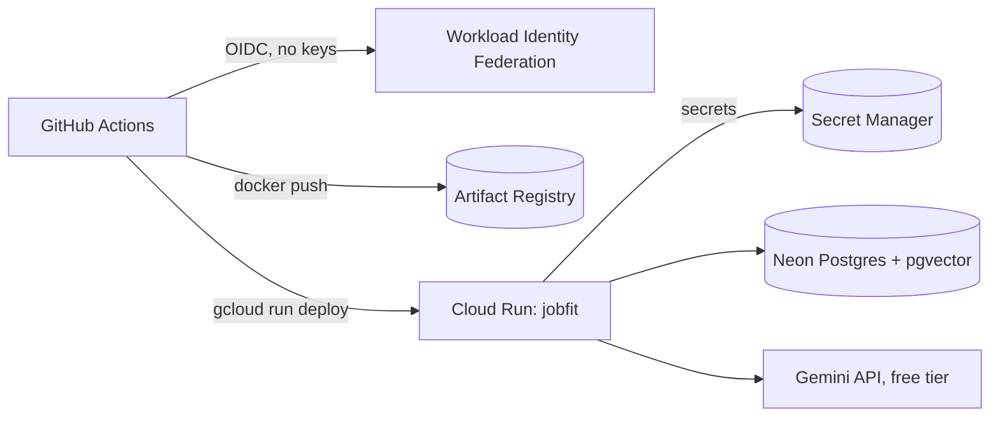

# Deploying the public demo to Google Cloud Run

The demo runs as **one Cloud Run service** (FastAPI serves the API and the built Angular app),
with **Neon** as the Postgres + pgvector database and **Gemini** on the free tier.
Infrastructure is defined in [`infra/`](../infra) (Terraform) and every green build on `main` is
deployed by [`.github/workflows/deploy.yml`](../.github/workflows/deploy.yml).



## What it costs

| Part | Free allowance | Expected cost |
| --- | --- | --- |
| Cloud Run (request-based billing, `europe-west1`) | 2M requests, 180k vCPU-s, 360k GiB-s per month | 0 for portfolio traffic |
| Neon Free plan | ~100 CU-hours, 1 GB storage; never bills overages | 0 |
| Gemini API, key from a project **without billing** | low rate limits; over the limit you get HTTP 429, not a bill | 0 |
| Artifact Registry | 0.5 GB; a cleanup policy keeps the 2 newest images | ~0 |
| Secret Manager | 6 active secret versions | 0 |

Built-in limits: `max_instance_count = 1`, 1 vCPU / 512 MiB, scale to zero, 20 AI requests
per IP per hour. Even an instance kept busy 24/7 for a month would cost about USD 60 - and the
spend cap below stops Cloud Run long before that.

## 1. Accounts (done by you)

1. **Google Cloud** - sign up at <https://cloud.google.com/free> (90 days, USD 300 credit; nothing is
   charged unless you upgrade). Create a project, e.g. `jobfit-demo`, and note its **project ID**.
2. **Spend caps - before deploying anything.** Billing → *Budgets & alerts* → *Create budget*,
   type **Spend cap**, scope: your project, service **Cloud Run**, amount e.g. 20 PLN.
   Create a second one for the **Gemini API** service. Add one *alerts-only* budget for the
   whole billing account (e.g. 20 PLN) to get e-mails at 50/90/100 %.
3. **Neon** - <https://neon.com>, sign in with GitHub, create a project in **AWS Europe Central 1
   (Frankfurt)**. Copy the connection string with **connection pooling turned off** (direct host).
   The `vector` extension is created by the first migration.
4. **Gemini key** - <https://aistudio.google.com> → *Get API key*. Create it in a **separate
   project that has no billing account**. A key from a billed project uses paid limits.

## 2. Tools

Install the [Google Cloud CLI](https://cloud.google.com/sdk/docs/install) and
[Terraform](https://developer.hashicorp.com/terraform/install) (or run Terraform with
`docker run hashicorp/terraform`), then:

```bash
gcloud auth login
gcloud auth application-default login
gcloud config set project YOUR_PROJECT_ID
gcloud services enable secretmanager.googleapis.com
```

## 3. Secrets (typed by you, never stored in files)

On Windows the easiest way is the helper script. It asks for the Neon URL and the Gemini key
without echoing them, generates the admin token and stores everything in Secret Manager and
the `DEMO_ADMIN_TOKEN` GitHub secret:

```powershell
powershell -ExecutionPolicy Bypass -File .\infra\setup-secrets.ps1 -ProjectId YOUR_PROJECT_ID
```

Manually, each command reads the value from standard input: paste it, press Enter, then
Ctrl+Z and Enter on Windows (Ctrl+D on macOS/Linux). Trailing newlines are ignored by the app.

```bash
gcloud secrets create jobfit-database-url --replication-policy=automatic --data-file=-
gcloud secrets create jobfit-google-api-key --replication-policy=automatic --data-file=-
gcloud secrets create jobfit-admin-token --replication-policy=automatic --data-file=-
```

Generate the admin token (used by the nightly demo reset) with
`python -c "import secrets; print(secrets.token_urlsafe(32))"` and also save it in GitHub:

```bash
gh secret set DEMO_ADMIN_TOKEN --repo Wojgos/jobfit
```

## 4. Infrastructure

```bash
cd infra
cp terraform.tfvars.example terraform.tfvars   # set project_id
terraform init
terraform apply
```

Terraform creates the Artifact Registry repository, the Cloud Run service (with a placeholder
image), the runtime service account with access to the three secrets, and Workload Identity
Federation so that only `main` of this repository can deploy. State stays local in `infra/`.

If `gcloud auth application-default login` is not an option, give Terraform a short-lived
token from your gcloud login instead: `$env:GOOGLE_OAUTH_ACCESS_TOKEN = gcloud auth print-access-token`
(PowerShell) or `export GOOGLE_OAUTH_ACCESS_TOKEN=$(gcloud auth print-access-token)`.

In a brand-new project the first Cloud Run revision can fail with *"internal error"* while the
freshly enabled APIs and IAM bindings propagate. Run `terraform apply` again a few minutes later:
the failed service is tainted and gets recreated.

## 5. Connect GitHub Actions

Copy the `github_variables` output into repository variables:

```bash
terraform output -json github_variables
gh variable set GCP_PROJECT_ID   --repo Wojgos/jobfit --body "..."
gh variable set GCP_REGION       --repo Wojgos/jobfit --body "europe-west1"
gh variable set GCP_WIF_PROVIDER --repo Wojgos/jobfit --body "projects/.../providers/github"
gh variable set GCP_DEPLOY_SA    --repo Wojgos/jobfit --body "jobfit-deployer@....iam.gserviceaccount.com"
gh variable set DEMO_URL         --repo Wojgos/jobfit --body "https://jobfit-....run.app"
```

Then run **Actions → deploy → Run workflow** (later deploys happen automatically after CI on
`main`). On the first start the app runs migrations and seeds the sample data.

## Removing everything

```bash
cd infra && terraform destroy
```

Delete the Neon project and, if you upgraded, close the billing account in the console.
